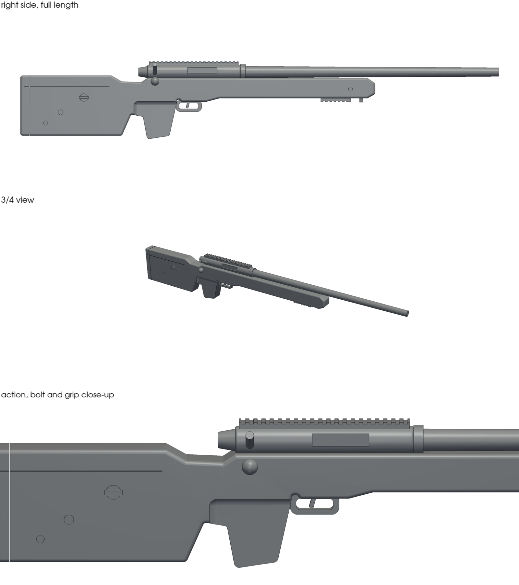

# Sniper rifle display replica (1:1, one piece)

Full-size, solid display prop of a bolt-action sniper rifle in the M40 /
Remington 700 style with a tactical adjustable stock. It is a single solid
body with no working parts and a blocked muzzle.

| | |
|---|---|
| Overall length | 1130 mm |
| Height | 182 mm |
| Width | 44 mm stock (92 mm including bolt knob and side knobs) |
| Solid volume | ~3.6 L (about 4.5 kg of PLA at 100 % infill; roughly 1.2–1.5 kg at 15 % infill with 3 walls) |

## Files

- `sniper_replica.stl` – the printable model (watertight, checked with `stl-check`)
- `build.py` – parametric source (build123d). Edit dimensions at the top and run `python3 build.py`
- `preview.png` – renders

## Printing notes

- At 1130 mm long it is larger than almost every consumer printer bed
  (a typical bed is 220–350 mm). As one piece it needs a large-format
  printer or a print service.
- Print lying on its side for the strongest barrel; the bolt knob and side
  knobs will need supports.
