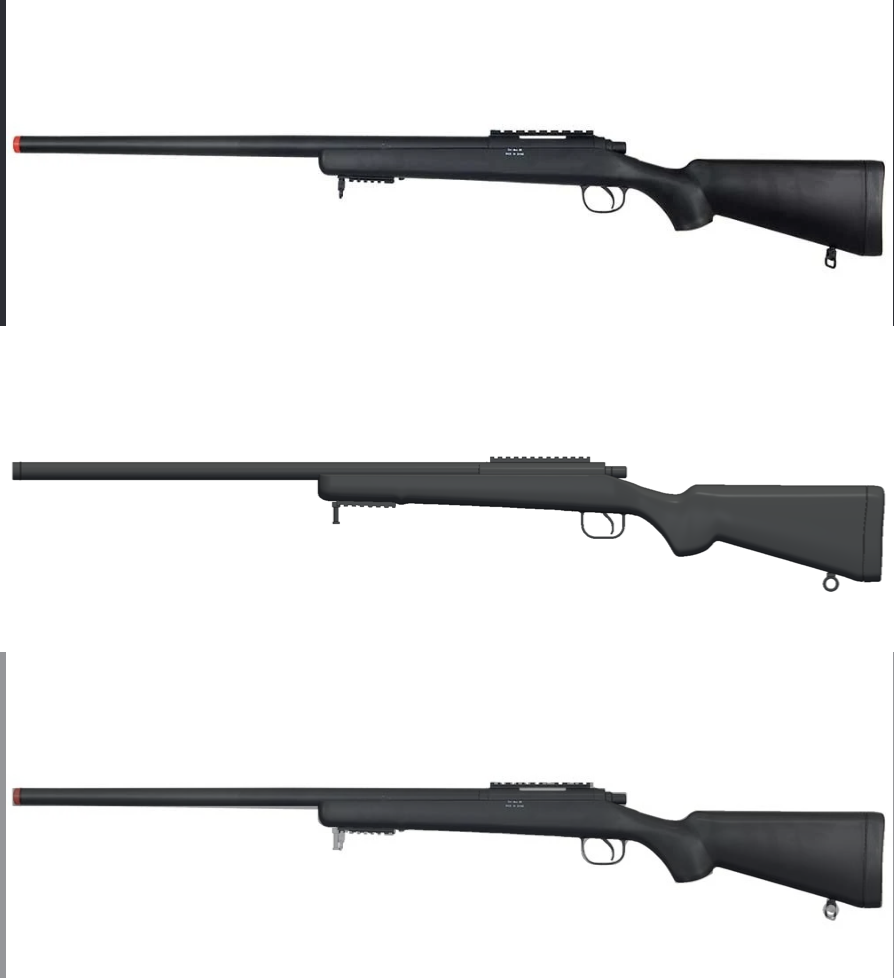
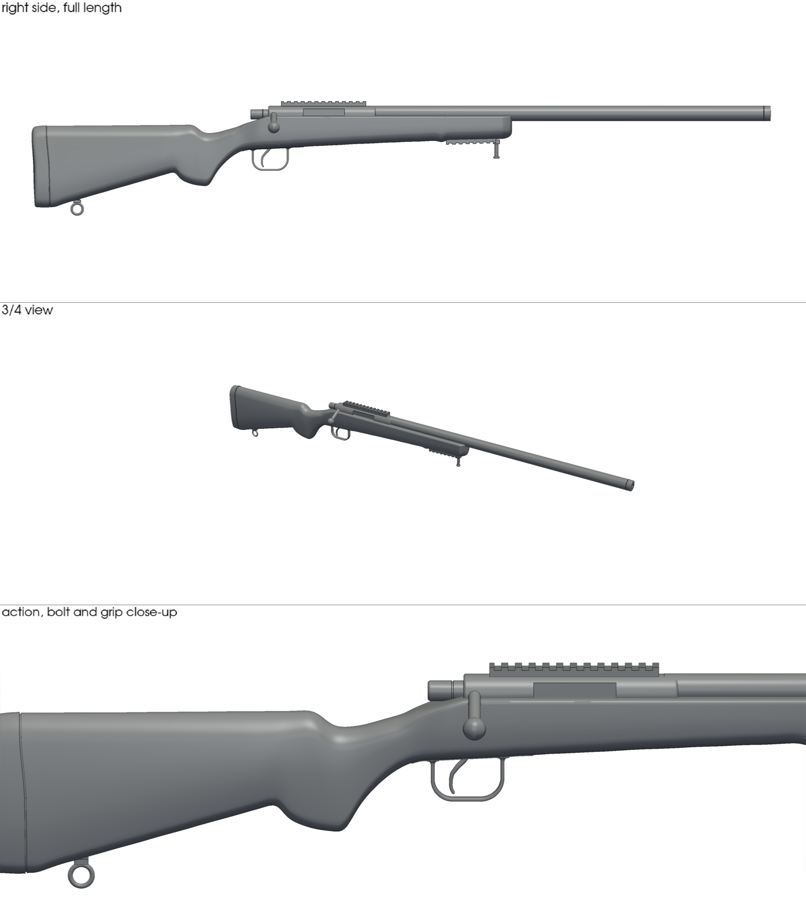

# VSR-10 style rifle display replica (1:1, one piece)

Full-size, solid display prop of a VSR-10 style bolt-action airsoft rifle with
a sporter stock. It is a single solid body with no working parts and a
blocked muzzle.

The stock's side outline is traced from `reference.png` to sub-pixel
precision (`trace_profile.py` -> `stock_profile.json`) and scaled to the
VSR-10's published overall length of 1075 mm (1.234 mm per pixel). The stock
is a smooth loft of cross-sections along that outline: an egg-shaped butt
with a round comb, a wrist and pistol grip that blend into it without seams,
a flat-topped action area and a rounded forend belly. The recoil pad is a
separate 21 mm band with a parting groove, a slightly domed face, a rounded
heel and the forward lean of the pad face measured from the photo. The
trigger guard follows the photo too: a base plate inlaid in the underside
with a screw at each end, an open bow whose ends flare into the plate with
rounded shoulders, and a tapered, curved trigger coming out of a slot.
`comparison.png` shows the photo, the model rendered at the same scale, and
the two overlaid.

| | |
|---|---|
| Overall length | 1075 mm |
| Height | 166 mm (including sling swivel and bipod post) |
| Width | 41 mm butt (42 mm over the pad), 32 mm wrist/grip, 40 mm action and forend (72 mm including bolt knob) |
| Solid volume | ~1.72 L (about 2.1 kg of PLA at 100 % infill; roughly 0.7–0.9 kg at 15 % infill with 3 walls) |

## Files

- `vsr10_replica.stl` – the printable model (one watertight solid, checked with `stl-check`)
- `trace_profile.py` – traces the stock outline from the photo into `stock_profile.json`
- `build.py` – model source: lofted stock mesh plus build123d metal parts, joined with
  manifold3d; run `python3 trace_profile.py && python3 build.py`
- `reference.png`, `comparison.png`, `preview.png`

The stock's cross-section shape is set by the keyframes in `SHAPE` at the top
of `build.py` (crown width and height, widest point, bottom rounding), so it
can be reshaped without touching the traced outline.

## Limits

- The photo is a single side view, so widths are typical sporter-stock
  values, not measured, and the hidden right side (bolt handle, ejection
  port) follows the standard VSR-10 layout.
- At 1075 mm long it exceeds almost every consumer printer bed; as one piece
  it needs a large-format printer or a print service.
